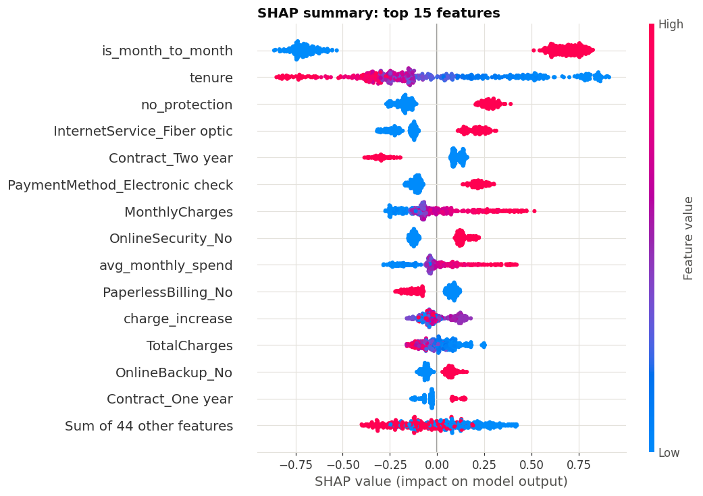
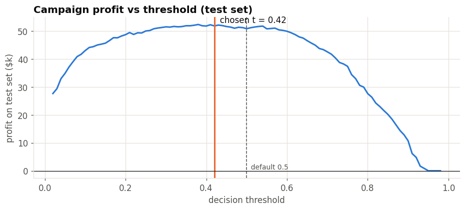

# Customer Churn Prediction · Telecom

   

End-to-end machine-learning project that predicts which telecom subscribers will cancel, explains **why**, and turns the scores into a **profit-optimal retention policy**.

## Business question
The retention team can contact only a limited number of customers. They need:
1. a ranked list of customers most likely to churn,
2. the drivers of each customer's risk (to choose the right offer),
3. a decision rule (threshold) that maximises campaign profit.

## Pipeline
| Step | What is done |
|---|---|
| 1. Audit | types, blanks, duplicates; domain-correct fix of `TotalCharges` for new customers |
| 2. EDA | churn by contract, service, payment method and tenure |
| 3. Feature engineering | 8 domain features (services count, price increase, auto-pay, protection gap, lifecycle stage...) |
| 4. Modelling | leak-free `Pipeline` + `ColumnTransformer`, 5-fold stratified CV of 5 models |
| 5. Tuning | Optuna (TPE) search over LightGBM; soft-voting ensemble candidate |
| 6. Evaluation | held-out test set: ROC-AUC, PR-AUC, calibration, classification report |
| 7. Business decision | threshold chosen on out-of-fold profit; lift by risk decile |
| 8. Explainability | SHAP beeswarm, dependence plots, per-customer waterfall |
| 9. Packaging | `joblib` artifact + `predict_churn()` inference function |

## Results
| Metric (held-out test set, 1,409 customers) | Value |
|---|---|
| Selected model | LightGBM tuned with Optuna (40 trials) |
| ROC-AUC | **0.848** |
| PR-AUC | **0.665** (random baseline 0.265) |
| Profit-optimal threshold (chosen on out-of-fold data) | 0.42 |
| Campaign profit on test set | **$51.8k** vs $50.8k at 0.5 and $27.5k contacting everyone |
| Churners caught at that threshold | 84% |
| Share of churners in the top-20% risk group | 51% (top-decile lift 2.8x) |

Cross-validated comparison: logistic regression 0.846 · random forest 0.845 · XGBoost 0.840 · LightGBM untuned 0.829 · **LightGBM tuned 0.850** ROC-AUC. The small gap with the linear model is a finding in itself: the signal is mostly linear.

**Main churn drivers (SHAP):** month-to-month contract, short tenure, internet without security/tech support (engineered `no_protection`), fiber-optic service, electronic-check payment, monthly charges above ~$90.

> Assumptions for the profit analysis (offer cost $50, 30% success rate, 12-month value) are explicit in the notebook and easy to change.

## Run it
The notebook is committed **with all outputs** from a Colab run. It renders with styled section headers on GitHub and [nbviewer](https://nbviewer.org/github/ahmedbouzidi304/customer-churn-prediction/blob/main/churn_prediction.ipynb); Colab shows the headers as plain text because it strips inline CSS.

Click **Open in Colab** above, then *Runtime → Run all* (CPU is enough, about 10 minutes).
Locally: `pip install -r requirements.txt` and open the notebook in Jupyter.

## Data
[IBM Telco Customer Churn](https://github.com/IBM/telco-customer-churn-on-icp4d) (7,043 customers, 21 columns), downloaded automatically.

## Tech stack
pandas · scikit-learn · LightGBM · XGBoost · Optuna · SHAP · matplotlib/seaborn
